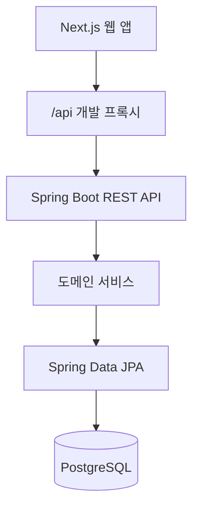
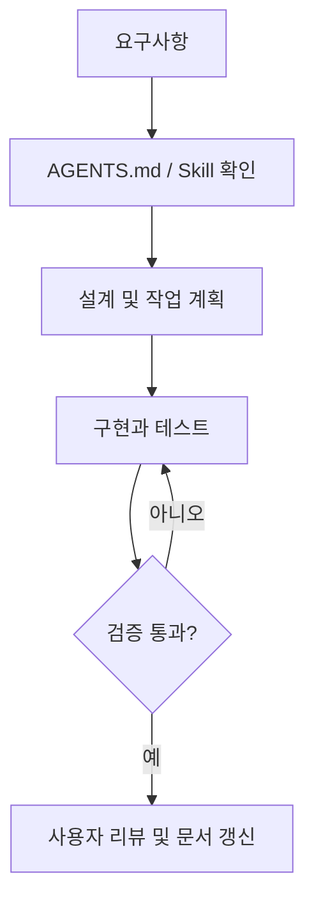

# AssetFlow — 프로젝트 통합 설계 및 개발 인계서

> **로컬 반영 상태 (2026-11-09)**: 사용자가 인증을 거래보다 먼저 진행하도록 선택했다. 회원가입·로그인·JWT/CSRF·계좌 소유권 검증을 구현했다. 아래 임시 memberId API 및 미검증 상태는 원본 작성 당시 기록이다. 현재 계약은 [docs/api-contract.md](docs/api-contract.md), 검증은 [docs/verification.md](docs/verification.md), 진행 범위는 [docs/PLAN.md](docs/PLAN.md)를 확인한다. ZIP 재해제나 기존 파일 덮어쓰기는 필요 없다.

> 기준일: 2026-11-09  
> 버전: v0.1 / Phase 1  
> 목적: Java/Spring Boot 학습 + FE/BE 개인 자산 관리 SaaS 구축 + Codex Harness 적용

## 1. 프로젝트 개요

**AssetFlow (Personal Finance Management SaaS)**는 자산, 부채, 수입, 지출을 통합 관리하고 현금흐름과 저축 목표를 확인하는 개인 금융 서비스다.

- 프로젝트 개발 비중: Java/Spring Boot 학습 **60%**, Harness 자동화·검증 **40%**
- FE/BE 학습 투자: 백엔드 중심. FE는 기존 Next.js 경험 활용
- 개발 방식: **PAIR** 기본, 핵심 Java 비즈니스 로직은 직접 이해·구현
- 아키텍처: **모듈형 모놀리스** + 기능별 패키지
- 로컬 작업 경로: `C:\work\assetflow`
- 레포지토리 이름: `assetflow`

### MVP 범위 및 우선순위

| 우선순위 | 기능 | 요구사항 |
|---|---|---|
| P0 | 회원·인증 | 회원가입, 로그인, JWT, 회원별 권한 |
| P0 | 계좌 | 현금·입출금·저축 계좌 생성 및 관리 |
| P0 | 거래 | 수입·지출·계좌 이체 등록·수정·조회 |
| P0 | 자산 현황 | 계좌별 잔액, 총자산, 순자산 |
| P1 | 부채 | 대출 원금·금리·상환 이력 |
| P1 | 통계 | 월별 현금흐름, 카테고리 집계 |
| P1 | 저축 목표 | 목표 금액·달성률 |
| P2 | 정기 거래 | 월세·고정지출 등록 |
| P2 | 알림 | 납부일·저축 목표 알림 |
| P2 | CSV | 거래 내보내기 |

**초기 MVP 완료 기준:** 인증된 회원이 계좌를 만들고 거래를 등록하면 잔액과 월별 수입·지출이 정확하게 집계되는 것. 실제 은행 연결, 금융 거래 실행, 투자 추천, AI 분석은 제외한다.

## 2. 기술 스택

| 레이어 | 기술 |
|---|---|
| FE | Next.js 16, React 19, TypeScript, CSS, lucide-react |
| BE | Java 21, Spring Boot 3.5, Spring Web, Validation, Spring Data JPA |
| DB | PostgreSQL 16, Flyway |
| 인증 (예정) | Spring Security + JWT |
| 테스트 | JUnit 5, Mockito; 이후 Testcontainers |
| 개발 환경 | Docker Compose, Gradle, npm |
| 배포 (예정) | GitHub Actions, Docker, AWS |
| AI 개발 | Codex + AGENTS.md + Skills + 검증 명령 |

## 3. 시스템 구조



- **Controller**: HTTP, DTO 입력 검증, 응답 및 상태 코드
- **Service**: 업무 규칙, 트랜잭션, 권한 검증
- **Repository**: 데이터 접근
- **Entity**: 영속 상태 및 도메인 변경 동작
- **DTO**: Entity 노출을 막고 FE/BE 데이터 계약을 통제
- **Frontend API Client**: `frontend/src/lib/api.ts`에서 호출을 모아 관리

### 현재 폴더 구조

```text
assetflow/
├── frontend/
│   ├── src/app/page.tsx
│   ├── src/app/globals.css
│   ├── src/lib/api.ts
│   └── next.config.ts
├── backend/
│   ├── src/main/java/com/assetflow/
│   │   ├── member/
│   │   ├── account/
│   │   └── global/exception/
│   ├── src/main/resources/db/migration/
│   └── src/test/
├── docs/
│   ├── architecture.md
│   ├── decisions.md
│   └── api-contract.md
├── .agents/skills/
├── AGENTS.md
├── CODEX_HANDOFF.md
├── compose.yaml
└── README.md
```

## 4. 데이터베이스 설계

### 현재 구현된 테이블

| 테이블 | 주요 필드 | 상태 |
|---|---|---|
| `members` | id, email, nickname, created_at | 구현 |
| `accounts` | id, member_id, name, type, opening_balance, currency, created_at | 구현 |

### 향후 확장 테이블 (설계안이며 미구현)

| 테이블 | 주요 필드 |
|---|---|
| `categories` | id, member_id, name, type |
| `financial_transactions` | id, account_id, category_id, transfer_id, type, amount, occurred_at, memo |
| `loans` | id, member_id, name, principal_amount, annual_interest_rate, status |
| `loan_repayments` | id, loan_id, principal_paid, interest_paid, paid_at |
| `savings_goals` | id, member_id, name, target_amount, target_date |

### DB/금액 규칙

1. Java 금액은 `BigDecimal`, PostgreSQL 금액은 `NUMERIC(19,2)`.
2. 거래 금액은 양수로 저장하며 `INCOME`, `EXPENSE`, `TRANSFER_IN`, `TRANSFER_OUT`으로 방향을 구분.
3. 계좌 이체는 출금/입금 두 거래를 `transfer_id`로 연결하고 통계에서 중복 집계를 피한다.
4. 계좌 잔액은 초기 잔액 + 수입 - 지출 ± 이체로 계산한다.
5. 대출 원금 상환과 이자는 별개로 집계한다.
6. 사용자별 데이터 접근 검증이 필수이며 인증 추가 전에는 외부 공개를 금지한다.
7. 스키마 변경은 Flyway migration으로 관리한다.

## 5. 현재 구현된 FE/BE 기능

| Method | Endpoint | 기능 | 상태 |
|---|---|---|---|
| POST | `/api/v1/members` | 학습용 회원 생성 | 구현 |
| GET | `/api/v1/members/{id}` | 회원 조회 | 구현 |
| POST | `/api/v1/accounts` | 계좌 생성 | 구현 |
| GET | `/api/v1/accounts?memberId={id}` | 계좌 목록 | 구현 |
| GET | `/api/v1/accounts/{id}?memberId={id}` | 계좌 상세 | 구현 |
| PATCH | `/api/v1/accounts/{id}?memberId={id}` | 계좌 이름 변경 | 구현 |

FE에는 회원 생성 모달, 계좌 추가 모달, 계좌 목록, 총 잔액·저축 잔액·계좌 수 카드, 로딩/빈 상태/오류 UI, 반응형 레이아웃을 작성했다.

**주의:** 위의 “구현”은 코드를 작성했다는 뜻이며, 로컬 통합 테스트까지 완료했다는 의미는 아니다. 현재 `balance`는 실제 거래 합계가 아닌 `openingBalance`다. 인증/인가는 구현되지 않았다.

## 6. Codex Harness

### 구성 요소

| 파일/폴더 | 역할 |
|---|---|
| `AGENTS.md` | 공통 프로젝트 규칙, 작업 흐름, 학습 모드 |
| `.agents/skills/java-learning/` | Java 개념·힌트·코드 리뷰 |
| `.agents/skills/spring-api/` | Spring API 설계·구현·검증 |
| `.agents/skills/backend-review/` | 보안·트랜잭션·성능·테스트 리뷰 |
| `.agents/skills/frontend-feature/` | Next.js 구현과 UI 상태 검증 |
| `.agents/skills/fullstack-contract/` | DTO/FE 타입/API 경로 계약 점검 |
| `docs/` | 아키텍처·설계 결정·API 계약 |

### 협업 모드

- `LEARNING`: AI가 핵심 정답 구현을 먼저 제시하지 않고 개념 → 힌트 → 사용자 구현 → 피드백 진행.
- `PAIR`(기본): 설계 논의 + 사용자 핵심 구현 + AI 보조 코드/테스트/검증.
- `AUTO`: 명시적으로 위임된 반복 작업만 자동화.

### 자동 검증 흐름



핵심 원칙: 검증을 실행하지 않았다면 통과로 보고하지 않는다. API 변경 시 Java DTO, TypeScript 타입, `docs/api-contract.md`를 함께 확인한다.

## 7. 6주 개발 로드맵

| 기간 | 학습·구현 항목 | 산출물 |
|---|---|---|
| 1주차 | Java 객체지향, Spring 기초, 회원/계좌 CRUD, Harness 기본 설정 | 실행 가능한 FE/BE 스타터 |
| 2주차 | JPA 연관관계, 거래 도메인, 금액 계산, 트랜잭션 | 수입·지출·이체 API |
| 3주차 | Spring Security, JWT, 권한, 테스트 | 인증과 사용자별 데이터 보호 |
| 4주차 | 단위/통합 테스트, Testcontainers, 정적 분석, CI | 자동 검증 파이프라인 |
| 5~6주차 | FE 연동 확장, 대출·통계·저축, Docker/AWS 배포 검토 | MVP 기능 완성 및 문서 |

### 첫 주 세부 학습 계획 (약 15시간)

| 일차 | 주제 | 학습·개발 |
|---|---|---|
| Day 1 (2h) | 환경 구축 | JDK, Gradle, Docker/PostgreSQL, AGENTS.md, 빌드 |
| Day 2 (2h) | Java 복습 | Class, Interface, Enum, Record, Stream, BigDecimal, JUnit |
| Day 3 (2h) | JPA 회원 | Entity, Repository, DTO, 영속성 컨텍스트 |
| Day 4 (3h) | 계좌 API | Controller, Service, Validation, 예외 처리 |
| Day 5 (2h) | 테스트 | Mockito, 성공·실패 시나리오 |
| Day 6 (3h) | Harness | Java 학습 Skill, 백엔드 리뷰, 검증 명령 |
| Day 7 (1h) | 회고 | 코드 구조, 학습 정리, 거래 도메인 요구사항 |

## 8. 실행 방법 (Windows)

준비물: JDK 21, Gradle 8.14+, Node.js 22 LTS 권장, Docker Desktop.

```powershell
cd C:\work\assetflow
docker compose up -d
```

별도 터미널 (BE):

```powershell
cd C:\work\assetflow\backend
gradle bootRun
```

별도 터미널 (FE):

```powershell
cd C:\work\assetflow\frontend
npm install
npm run dev
```

브라우저: `http://localhost:3000`

검증 명령:

```powershell
# backend에서
gradle test

# frontend에서
npm run typecheck
npm run lint
npm run build
```

현재 제공한 프로젝트에 Gradle Wrapper가 없으므로 Gradle 설치 후 `gradle wrapper`로 생성하는 절차가 필요하다.

## 9. 검증 상태 및 위험

| 항목 | 상태 |
|---|---|
| FE/BE/Harness 코드 작성 | 완료 |
| ZIP 무결성 검사 | 완료 |
| FE package.json/tsconfig JSON 구문 확인 | 완료 |
| FE 의존성 설치 및 프로덕션 빌드 | 미검증 (네트워크 제약) |
| BE Gradle 빌드/테스트 | 미검증 (Java 21·Gradle/Docker 미설치 환경) |
| FE ↔ BE 실제 통합 시나리오 | 미검증 |
| Windows 로컬 폴더 직접 수정 | 미수행 (현재 도구에서 PC 경로 접근 불가) |
| Codex 로컬 프로젝트 생성 | 미수행 (사용자 PC에서 연결 필요) |

**보안:** 현재는 학습용 회원 ID를 브라우저 localStorage에 보관하고, API에서 `memberId`를 직접 받는다. 이는 접근 제어가 아니라 임시 데모 기능이며 다른 회원 ID 접근이 가능하므로 외부 배포 및 실제 데이터 사용을 금지한다.

## 10. Codex 인계 및 첫 작업

1. 프로젝트 소스를 로컬 작업 폴더에 준비한다. 기존 파일을 ZIP으로 덮어쓰지 않는다.
2. 이 문서 및 `CODEX_HANDOFF.md`를 프로젝트 루트에 복사.
3. Codex에서 **AssetFlow** 로컬 프로젝트를 만들고 해당 폴더를 primary root로 설정.
4. 다음 프롬프트로 시작.

```text
AssetFlow 프로젝트를 이어서 개발하려고 합니다.
작업 루트는 C:\work\assetflow 입니다.

AGENTS.md, ASSETFLOW_PROJECT_MASTER.md, CODEX_HANDOFF.md,
README.md 및 docs/*를 먼저 읽고 FE/BE/Harness 구조를 확인해 주세요.

핵심 목표는 Java/Spring Boot 학습 60%, Harness 구축 40%이고
개발 방식은 PAIR입니다. 핵심 Java 로직은 한국어 주석과 학습 포인트를
설명하면서 제가 직접 이해하도록 도와주세요.

먼저 사용자 변경 사항과 Git 상태를 보존하고,
1. 개발 환경 점검
2. BE Gradle 빌드·테스트
3. FE 타입체크·Lint·빌드
4. PostgreSQL 연결
5. 회원 생성 → 계좌 등록 → 조회 통합 확인
을 진행해 주세요.

검증 결과를 docs/verification.md에 기록하고,
그 다음 거래(수입/지출/이체) 도메인 설계를 제안해 주세요.
새로운 DB/아키텍처 변경은 구현 전에 설명해 주세요.
```

## 11. 다음 우선순위

1. **P0 — 기존 스캐폴딩 실행 검증**: Windows에서 실제 FE/BE 실행, 실패 수정, 검증 기록.
2. **P0 — 회원·계좌 플로우 검증**: CRUD 및 API 계약 확인.
3. **P1 — 거래 도메인 설계**: 카테고리, 거래 타입, 이체 원자성, 계좌 잔액 집계.
4. **P1 — 인증·인가 설계**: Spring Security/JWT 도입, 클라이언트 `memberId` 제거.
5. **P2 — Harness 검증 고도화**: Testcontainers, CI, API 계약 자동 테스트.

---

### 관련 문서

- `AGENTS.md`: Codex 공통 규칙
- `CODEX_HANDOFF.md`: Codex 첫 인계 문서
- `README.md`: 실행 안내
- `docs/architecture.md`: 구조 설명
- `docs/api-contract.md`: FE/BE 계약
- `docs/decisions.md`: 설계 결정 기록

본 문서는 지금까지의 설계와 작성된 코드 상태를 종합한 것이다. 이후 변경은 실제 로컬 레포지토리의 파일과 테스트 결과를 기준으로 갱신한다.
