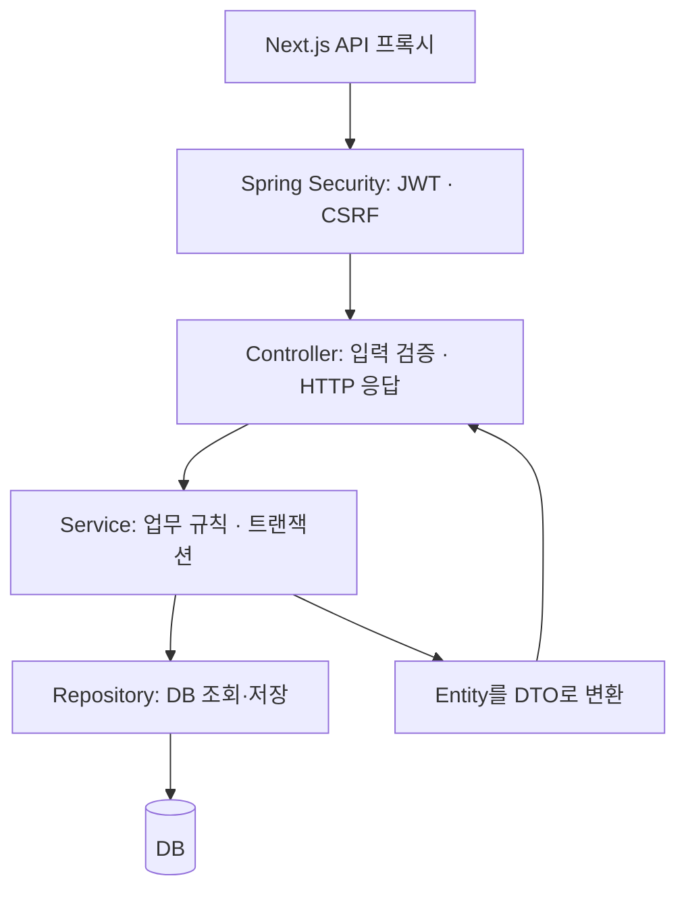

# 백엔드 코드 해설

현재 구현 기준: 회원가입·로그인·JWT 쿠키·CSRF·회원별 계좌 관리. 거래 기반 잔액 집계는 아직 없다. 이 문서는 코드의 동작과 이유를 설명하며 구현 변경을 포함하지 않는다.

## 1. 먼저 잡을 구조

Spring은 생성자에 필요한 객체를 주입한다. Controller는 요청과 응답을 연결하고, Service는 업무 규칙과 트랜잭션을 묶으며, Repository는 DB 접근을 맡는다. Entity는 저장할 상태와 변경 동작을 표현하고 DTO는 외부에 허용할 입력·출력을 고정한다. 인증 필터는 Controller보다 먼저 실행되지만, 특정 계좌의 소유권은 서비스가 추가로 검사한다.

기능별 패키지 `auth`, `member`, `account` 안에 계층을 두는 구조다. `AssetFlowApplication`이 `com.assetflow`에 있어 그 하위 클래스들이 자동 탐색된다. 테이블 정의는 Entity가 자동 생성하지 않고 Flyway가 적용하며 JPA는 `ddl-auto=validate`로 매핑을 검증한다.

## 2. 추천 읽기 순서

아래 Java 경로는 `backend/src/main/java/com/assetflow/` 기준이다.

| 순서 | 파일 | 읽을 핵심 |
|---|---|---|
| 1 | `member/domain/Member.java` | Entity, ID 생성, 비밀번호 해시, 생성자 |
| 2 | `account/domain/Account.java` | 연관관계, BigDecimal, 도메인 메서드 |
| 3 | `account/dto/CreateAccountRequest.java` | record와 Bean Validation |
| 4 | `account/repository/AccountRepository.java` | 메서드 이름으로 만드는 조회 |
| 5 | `account/service/AccountService.java` | 유스케이스, 소유권, 변경 감지 |
| 6 | `account/controller/AccountController.java` | HTTP와 인증 주체 연결 |
| 7 | `auth/service/AuthService.java` | 가입과 비밀번호 비교 |
| 8 | `auth/service/TokenService.java` | JWT 내용과 쿠키 |
| 9 | `auth/config/SecurityConfig.java` | 인증·CSRF·허용 경로 |
| 10 | `auth/controller/AuthController.java` | 인증 API 전체 연결 |
| 11 | `global/exception/ApiExceptionHandler.java` | 실패를 응답으로 변환 |

## 3. 회원가입은 어떻게 처리되나

1. FE가 `GET /api/v1/auth/csrf`로 토큰과 쿠키를 받는다.
2. `POST /api/v1/auth/register`에 이메일·닉네임·비밀번호와 CSRF 헤더를 보낸다.
3. 보안 필터가 CSRF를 검사한다. 가입 경로의 `permitAll`은 로그인만 면제하므로 CSRF는 여전히 필요하다.
4. Controller의 `@Valid`가 형식·공백·길이 등을 검사한다.
5. `AuthService.register`가 비밀번호의 UTF-8 바이트 길이, 이메일 중복, 닉네임을 확인한다.
6. `PasswordEncoder.encode`가 BCrypt 해시를 만들고 `Member`에는 해시만 저장한다.
7. `saveAndFlush`가 DB에 SQL을 반영한다. 아직 commit을 뜻하지는 않는다. 같은 이메일의 동시 가입은 DB UNIQUE 제약이 최종적으로 막는다.
8. 서비스 트랜잭션이 정상 완료되면 Controller가 JWT 쿠키와 201 응답을 만든다. 본문은 `MemberResponse`다.

비밀번호는 trim하지 않는다. 사용자가 비밀번호에 넣은 공백도 입력의 일부이기 때문이다. 이메일·닉네임은 현재 서비스에서 trim한다. 이메일의 대소문자를 통일하는 처리는 현재 없다.

## 4. 비밀번호와 JWT는 역할이 다르다

| 값 | 목적 | 현재 처리 |
|---|---|---|
| 비밀번호 | 로그인 시 본인 확인 | 입력값을 해시와 `matches`로 비교 |
| BCrypt 해시 | 평문 대신 DB에 보관 | `members.password_hash`, 응답 DTO에서 제외 |
| JWT | 이후 요청의 로그인 증명 | 서명된 토큰을 인증 쿠키에 보관 |
| CSRF 토큰 | 자동 전송되는 쿠키를 악용한 변경 요청 방어 | 별도 쿠키와 요청 헤더를 검사 |

BCrypt 해시는 복호화해서 비밀번호를 꺼내는 값이 아니다. 같은 비밀번호도 해시 생성 시 서로 다른 결과가 나올 수 있으므로 문자열을 직접 비교하지 않고 `matches`를 사용한다. DTO의 `@Size`는 문자열 길이를 검사하고, 서비스의 바이트 검사는 BCrypt 입력의 UTF-8 72바이트 제한을 보완한다.

로그인에서 회원을 못 찾거나 기존 회원의 해시가 null이어도 더미 해시로 비교를 수행한다. 이는 성공시키기 위한 기본 비밀번호가 아니라 계정 존재 여부에 따른 처리 시간 차이를 줄이기 위한 장치다. 로그인 실패 문구도 동일하다.

JWT의 `sub`에는 회원 ID, `iss`에는 발급자, `iat`/`exp`에는 발급·만료 시각을 담는다. HS256 서명과 발급자·시간 검증은 라이브러리에 맡긴다. JWT 내용은 암호화되지 않으므로 민감한 값을 넣지 않는다. 비밀 키를 바꾸면 이전 키로 서명한 토큰은 검증되지 않는다.

## 5. 보안 설정을 읽을 때 구분할 것

- `jwtKey`: 환경변수를 HMAC 키로 바꾸고 최소 바이트 길이를 검사한다. 길이가 충분하다고 무작위성까지 보장하는 것은 아니다.
- `jwtEncoder` / `jwtDecoder`: 각각 발급과 검증을 담당한다. 현재 허용 알고리즘은 HS256이다.
- `cookieTokenResolver`: `assetflow_access` 쿠키에서만 JWT를 읽는다. 현재는 Authorization 헤더를 인증 경로로 사용하지 않는다.
- 공개 인증 경로: 만료 쿠키가 남아도 로그인·가입·CSRF 발급·로그아웃이 막히지 않도록 JWT 추출을 생략한다.
- `STATELESS`: 서버 세션에 로그인 상태를 보관하지 않는다. 회원 정보가 DB에 저장되지 않는다는 의미는 아니다.
- `CookieCsrfTokenRepository`: CSRF 값을 쿠키에 저장한다. FE에는 `/auth/csrf` 응답을 통해 기본 핸들러가 마스킹한 토큰을 전달한다.
- `HttpOnly`: JavaScript의 쿠키 읽기를 막는다. 쿠키 자동 전송이나 모든 종류의 XSS 피해를 막아주는 설정은 아니다.
- `Secure`: HTTPS에서만 쿠키를 전송하도록 한다. 현재 로컬 HTTP 설정은 false이며 HTTPS 환경에서는 true가 필요하다.
- `SameSite=Strict`: 쿠키의 사이트 간 전송을 제한한다. 현재 코드에서는 여기에 의존해 CSRF 검사를 끄지 않는다.

토큰 수명은 30분으로 발급한다. refresh token은 없으며 만료 후 재로그인한다. 로그아웃은 같은 이름·경로의 쿠키를 만료시킨다. 탈취한 토큰을 서버에서 즉시 무효화하는 폐기 목록은 구현하지 않았다.

## 6. 계좌 소유권과 JPA 변경 감지

`AccountController`는 요청 JSON/query의 회원 ID를 사용하지 않고, 검증된 JWT의 subject를 Long으로 변환해 서비스에 전달한다. `AccountService`의 파라미터만 보면 단순한 Long이지만, 어떤 호출자가 그 값을 넘기는지까지 함께 봐야 보안 경계를 이해할 수 있다.

- 생성: DB에서 회원 존재를 확인하고 `Account`를 만들어 저장한다.
- 목록: `findAllByMemberIdOrderByIdDesc`는 `member.id` 조건으로 조회하고 계좌 ID 내림차순으로 정렬한다. 결과가 없으면 빈 목록이다.
- 상세·수정: `findByIdAndMemberId`로 계좌 ID와 소유자 ID를 함께 검사한다. 다른 회원 계좌와 없는 계좌를 같은 404로 처리한다.

이름 변경은 `@Transactional` 안에서 조회한 Entity에 `rename`을 호출한다. JPA의 영속성 컨텍스트가 조회 객체를 관리하고, flush 시점에 변경을 감지해 UPDATE를 실행한다. 그래서 서비스에서 `save`를 다시 호출하지 않는다. DTO에 수정된 이름을 넣어도 트랜잭션 commit에 실패하면 정상 응답으로 완료되지 않는다.

`readOnly=true`는 읽기 의도와 최적화를 위한 설정이다. 데이터 소유권 검사나 DB 쓰기 권한을 대신하지 않는다. `LAZY`는 연관 회원 로딩을 늦추는 설정이며 특정 조회가 항상 한 번의 SQL로 끝난다는 보장은 아니다. Entity를 HTTP 직렬화에 넘기지 않고 트랜잭션 안에서 DTO로 바꾸는 이유도 이 경계 때문이다.

## 7. 금액과 검증의 현재 범위

`openingBalance`는 Java에서 BigDecimal, DB에서 NUMERIC(19,2)로 표현한다. 요청의 `@Digits(integer=17, fraction=2)`가 저장 정밀도와 맞물린다. Entity 생성자도 음수 초기 잔액을 거절하지만, 이름 공백·길이 등 모든 DTO 검증을 반복하지는 않는다. 특히 `rename`은 현재 필드 대입만 하고 공백 검사는 HTTP DTO에 있다.

`AccountResponse.balance`는 현재 초기 잔액을 그대로 담는다. Stream의 `.map(AccountResponse::from)`은 각 Entity에 정적 변환 메서드를 적용하는 문법이다. DTO를 분리했기 때문에 Entity에 내부 필드를 추가해도 응답에 자동 노출되지 않는다.

FE로 전달할 때 금액은 JSON number다. 따라서 Java의 BigDecimal 정밀도가 브라우저까지 그대로 보장된다고 해석하면 안 된다. 거래 합산과 큰 금액 계약은 후속 범위다.

## 8. 오류 처리와 테스트를 연결해서 읽기

| 상황 | 현재 처리 |
|---|---|
| JWT 누락·변조·만료 | 보안 필터에서 401 |
| CSRF 누락·불일치 | 보안 필터에서 403. 미로그인 변경 요청도 이 검사에 먼저 걸릴 수 있음 |
| DTO 검증 또는 잘못된 JSON | MVC 예외 처리에서 400 |
| 없는 회원/계좌 또는 타인 계좌 | BusinessException을 MVC에서 상태 코드와 메시지로 변환 |
| DB 무결성 제약 위반 | MVC 예외 처리에서 일반적인 409 문구 |

`BusinessException`은 RuntimeException이므로 기본 트랜잭션 규칙에서 롤백 대상이다. `ApiExceptionHandler`는 MVC 처리 중 예외를 담당하며 필터 단계의 오류는 `SecurityConfig`가 별도로 JSON 응답을 만든다.

테스트 경로는 `backend/src/test/java/com/assetflow/` 기준이다.

- `account/domain/AccountTest`: 순수 Java 객체의 이름 변경과 음수 잔액 거절. DB 검증은 아니다.
- `account/service/AccountServiceTest`: Mockito 저장소 대역으로 서비스 분기·매핑 확인. 실제 SQL이나 트랜잭션 검증은 아니다.
- `auth/AuthIntegrationTest`: 실제 Spring 보안 필터·JPA·Flyway를 MockMvc와 H2로 검증. 실제 PostgreSQL·브라우저 통합 검증은 아니다.
- `withCsrf`: 실제 토큰 발급 API에서 받은 쿠키와 토큰을 재사용하므로 CSRF 검사를 비활성화하지 않는다.

읽고 확인할 질문: “회원 ID를 요청에서 받으면 왜 위험한가?”, “rename 다음에 save가 없는 이유는 무엇인가?”, “JWT가 있어도 CSRF를 검사하는 이유는 무엇인가?”를 위 코드의 호출 흐름으로 설명해 본다.
